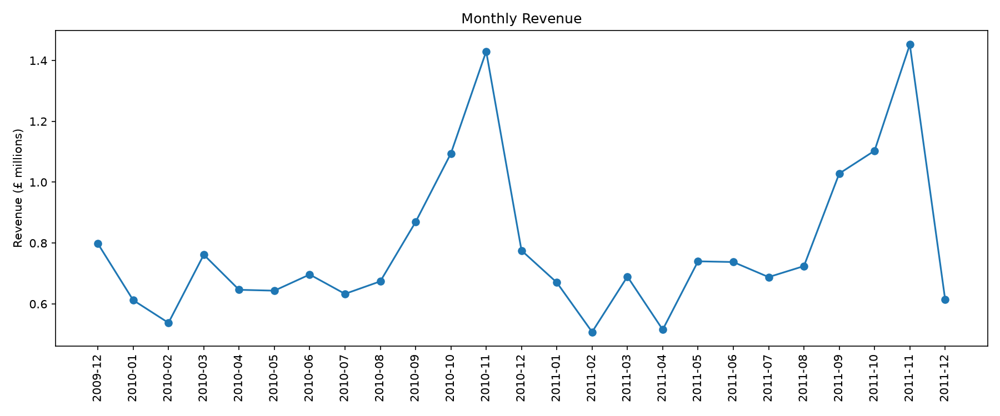
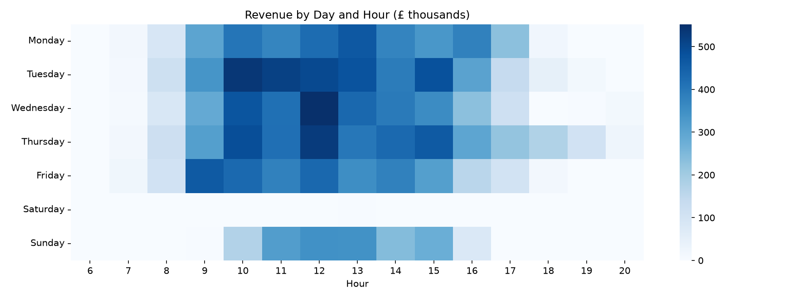
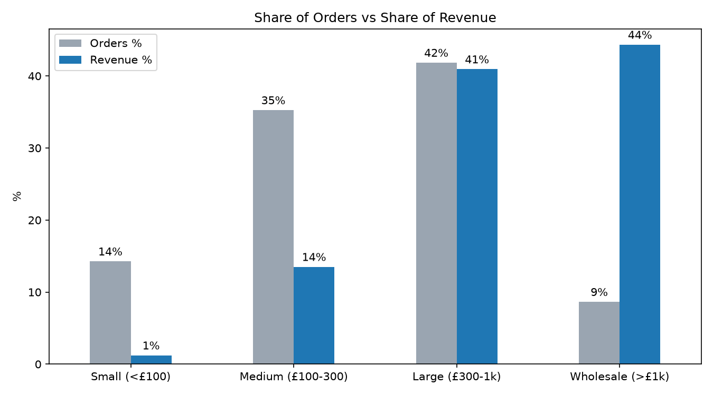
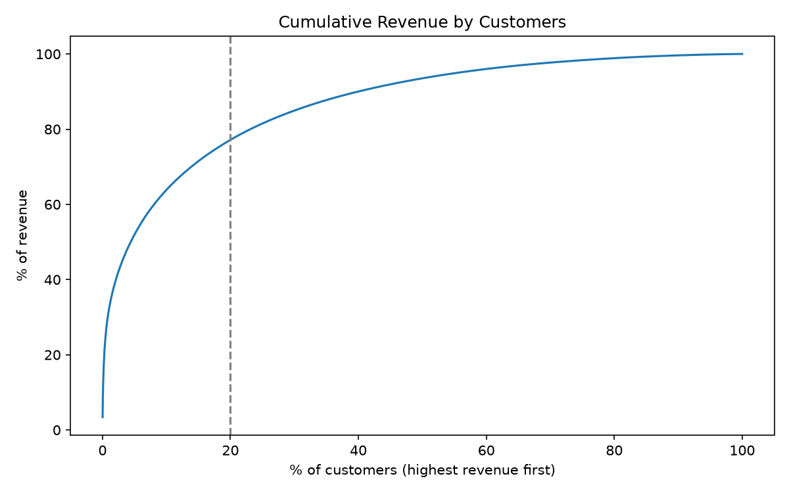
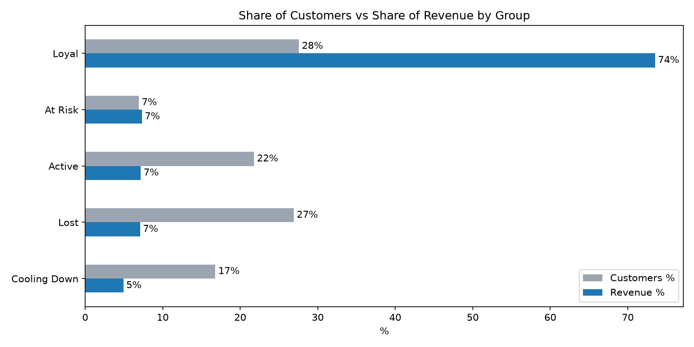
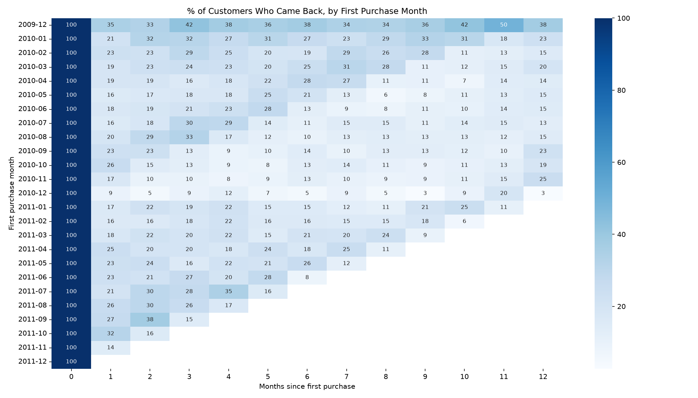

# Online Store Sales Analysis

I looked at 2 years of sales (Dec 2009 to Dec 2011) from a UK online gift shop to answer one question:

**Who are the customers that bring in the money, and how can the shop keep them?**

The data has about 1 million sales records. Many of the buyers are small shops that buy in bulk.

**Tools I used:** Python (pandas) for the numbers, and Matplotlib / Seaborn for the charts.

---

## What I Found

### 1. Sales are not growing, and most of them come before Christmas
Sales went up only 3% from 2010 to 2011. More than a third of the year's sales come in just 3 months: September, October and November.

### 2. Customers buy during working hours
75% of sales happen on weekdays between 10 AM and 4 PM. There are almost no sales on Saturday. This tells us most buyers are businesses, not individuals.

### 3. A few big orders bring in a big part of the money
Orders over £1,000 are only 9% of all orders, but they bring in 44% of the money.

### 4. A small group of customers matters the most
The top 20% of customers bring in 77% of the money. The top 1% alone bring in 32%.

### 5. 405 good customers have stopped buying
These customers used to order often (about 8 times each), but have not ordered for about 6 months. Together they spent about £1.25 million.

### 6. Most new customers don't come back
Only 1 in 5 new customers come back to buy again. 28% of all customers bought only once.

### 7. Customers outside the UK spend more per order
A normal order from outside the UK is about £421, compared to £295 from the UK.

---

## What I Recommend
1. **Bring back the 405 customers who stopped buying.** Contact them with an offer before the busy season starts in September.
2. **Get new customers to buy a second time.** Follow up with them in their first month.
3. **Take care of the biggest customers.** Give the top customers a dedicated contact person.

---

## How I Cleaned the Data
- Removed duplicate rows.
- Removed cancelled orders and returns.
- Removed charges that are not products (like postage and bank fees).
- About 23% of sales had no customer ID. I kept them in the total sales, but left them out when studying customers.

## How to Run
1. Download the data file `online_retail_II.csv` from [UCI](https://archive.ics.uci.edu/dataset/502/online+retail+ii) and put it in a folder called `DataSet`.
2. Run `pip install -r requirements.txt`
3. Open `Online_Retail_Analysis.ipynb` and run all cells.
